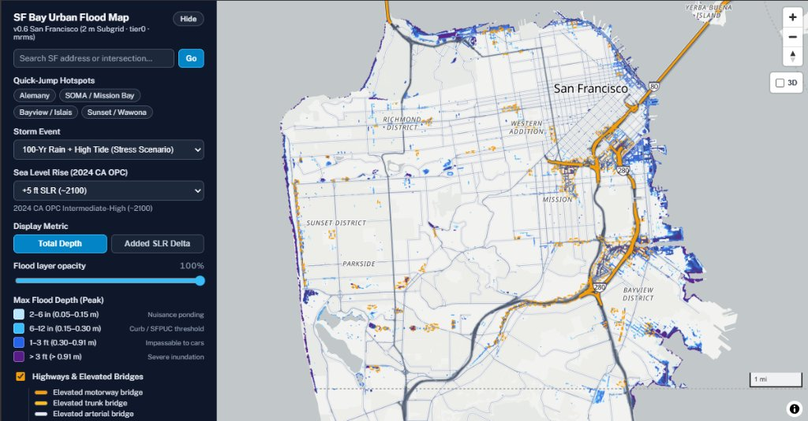

# bay-urban-flood-map

An open-source, screening-level 2D urban stormwater and compound sea level rise (SLR) flood model and static web viewer for the San Francisco Bay Area, built with HydroMT-SFINCS and MapLibre GL JS + Cloud Optimized GeoTIFFs (COGs).

[Live Flood Map](https://bay-urban-flood-map.pages.dev) · [About](https://bay-urban-flood-map.pages.dev/about.html) · [Methodology](https://bay-urban-flood-map.pages.dev/methodology.html) · v0.6.1 (San Francisco) · [Apache-2.0](LICENSE)

[](https://bay-urban-flood-map.pages.dev)

## Overview

FEMA floodplains focus on rivers and open coasts without modeling localized urban stormwater ponding, while coastal SLR viewers model rising Bay tides without rainfall runoff. `bay-urban-flood-map` couples 2D rain-on-grid overland flow (20 m computational grid with 2 m hydro-enforced LiDAR subgrid terrain) with dynamic Bay tidal boundaries to map where heavy rain pools in impervious urban bowls and where rising tides back up coastal outfalls.

Everything is served as static files. The Python pipeline (`pipeline/`) runs Deltares SFINCS locally in Docker and exports `EPSG:3857` COGs and lightweight GeoJSON overlays; the frontend (`web/`) streams those COGs directly in the browser over HTTP Range requests with client-side color ramps, 3D LiDAR terrain, and click-to-query flood depths.

> **Note:** This is an experimental, screening-level 2D overland pooling and coastal-compound flood model (see [docs/METHODS.md](docs/METHODS.md) and [docs/DECISIONS.md](docs/DECISIONS.md)). It does not model 1D underground storm-pipe networks and is not a regulatory FEMA flood map.

## Scenarios (San Francisco, v0.6.1)

- **Coincident stress scenarios (8 depth + 6 SLR delta COGs):** 10-year (90.4 mm / 24 hr) and 100-year (144.0 mm / 24 hr) NOAA Atlas 14 15-minute alternating-block rainfall paired with a 24-hr semidiurnal tide (MHHW + 0.35 m surge; undefined joint return period), crossed with fixed 0, +1, +3, and +5 ft water-level increments mapped to 2024 California Ocean Protection Council (OPC) guidance (NOAA SF gauge `9414290`, 2000 baseline):

| SLR Increment | 2024 CA OPC Mapping |
| :--- | :--- |
| 0 ft (0.00 m) | Baseline (Present Day) |
| +1 ft (0.30 m) | 2050 Intermediate (0.8 ft) / Intermediate-High (1.0 ft) |
| +3 ft (0.91 m) | 2100 Intermediate (3.1 ft) |
| +5 ft (1.52 m) | 2100 Intermediate-High (4.8 ft) |

- **Historical atmospheric river hindcasts (4 published COGs):** Oct 24, 2021; Dec 31, 2022; Jan 9, 2023; and Nov 22, 2024, forced with hourly 1 km NOAA MRMS gauge-corrected radar QPE and 4-gauge observed NOAA Bay tides. Feb 4, 2024 is kept as a documented sub-threshold holdout.

## Validation Summary (v0.6.1)

Evaluated against four open-data validation tiers plus a tide-boundary check. Full tables, sensitivity sweeps, and caveats are in the [Methodology page](https://bay-urban-flood-map.pages.dev/methodology.html) and reports ([calibration](docs/reports/sf_v06_calibration_report.md), [v0.6.1 rescore](docs/reports/sf_v061_rescore_report.md), [sensitivity](docs/reports/sf_v061_phase3_report.md)):

| Tier | Dataset | San Francisco Result (v0.6.1) |
| :--- | :--- | :--- |
| Boundary QA (Tier A) | NOAA CO-OPS `9414290` (Presidio, 5 ARs) | RMSE 0.0013–0.0019 m, 0.0 min peak timing error (forcing-gauge QA) |
| Hydraulic Benchmark (Tier B) | SFPUC 100-Yr Risk Map (`jzu3-4yxp`) & Elevations (`wppz-u2hi`) | Filtered (>= 5,574 m²) CSI 0.2344, FAR 0.5961 (raw CSI 0.1953); mutually wet depth Pearson r = 0.739 |
| Emergency Dispatches (Tier C) | SF DEM Traffic Hazards & SFFD Water Rescues (310 pts, 5 ARs) | Pooled 25 m right-of-way capture 32.90%, 1.346x lift, ROC-AUC 0.5567 |
| Civic Flood Reports (Tier D) | DataSF 311 Flood/Sewer Logs (2,071 pts, 5 ARs) | Pooled 25 m right-of-way capture 48.29%, 1.516x lift, ROC-AUC 0.6004 (Nov 22, 2024 holdout: 57.09%, 1.524x, 0.6125) |
| Insured Flood Losses (Tier E) | OpenFEMA NFIP Claims (259 tracts, 92 claims) | Flooded land area vs. claim count Spearman ρ = 0.2289 (p = 0.0002), Kendall τb = 0.1823, binary AUC 0.6765 |

## Quick Start

### Prerequisites
- Conda or Mamba (`conda-forge` only; see `environment.yml`)
- Docker (for running `deltares/sfincs-cpu` locally)
- Node.js (for `web/`)
- Manual input: download the [SFEI SF Bay Shore Inventory](https://www.sfei.org/data/sf-bay-shore-inventory-gis-data) (GNU GPL v3.0; portal blocks automated fetches) and extract it under `data/raw/sf_citywide/` per [docs/DATA_SOURCES.md](docs/DATA_SOURCES.md).

### Modeling Pipeline

```bash
conda env create -f environment.yml
conda activate bay-urban-flood-map

python pipeline/00_fetch_data.py --config configs/sf_citywide.yml
python pipeline/01_prep_terrain.py --config configs/sf_citywide.yml
python pipeline/02_build_sfincs.py --config configs/sf_citywide.yml --all-scenarios
python pipeline/03_validate_sf.py --config configs/sf_citywide.yml
python pipeline/04_export_cog.py --config configs/sf_citywide.yml --all-scenarios
```

Exported `EPSG:3857` COGs, GeoJSON overlays, and `manifest.json` are written to `data/web_outputs/` (see [docs/DATA_CONTRACTS.md](docs/DATA_CONTRACTS.md)).

Run Python tests and linter:
```bash
pytest
ruff check && ruff format --check
```

### Web Viewer

```bash
cd web
npm install
npm run dev
```

Run JS tests, linter, and production build:
```bash
cd web
node --test src/*.test.js
npm run lint
npm run build
```

## Repository Layout

| Path | Purpose |
| :--- | :--- |
| [pipeline/](pipeline/) | Data fetch, terrain hydro-enforcement, HydroMT-SFINCS runner, 5-tier validation and v0.6.1 rescore/sensitivity scripts, and `EPSG:3857` COG/overlay export |
| [configs/](configs/) | YAML scenario and physics configs (`sf_citywide.yml`, `sf_benchmark.yml`) |
| [web/](web/) | Vite + MapLibre GL JS static viewer (`index.html`, `about.html`, `methodology.html`) |
| [deploy/](deploy/) | Cloudflare R2 CORS policy and version-prefixed uploader (`upload_r2.sh`) |
| [docs/](docs/) | [METHODS.md](docs/METHODS.md), [MODEL_SPEC.md](docs/MODEL_SPEC.md), [VALIDATION_SPEC.md](docs/VALIDATION_SPEC.md), [DATA_CONTRACTS.md](docs/DATA_CONTRACTS.md), [WEB_SPEC.md](docs/WEB_SPEC.md), [DATA_SOURCES.md](docs/DATA_SOURCES.md), [DECISIONS.md](docs/DECISIONS.md), [reports/](docs/reports/), and [plan/ROADMAP.md](docs/plan/ROADMAP.md) |
| [tests/](tests/) | Offline `pytest` unit and regression suites |
| [CITATION.cff](CITATION.cff), [AGENTS.md](AGENTS.md) | Citation metadata and coding-agent invariants |

Next up on the roadmap: publishing v0.6.1 to Cloudflare R2/Pages with Zenodo Code and Dataset DOIs, followed by the v0.7 San Francisquito Creek / East Palo Alto separate-MS4 pilot and v1.0 Urban Bay Core mosaic. See [docs/plan/ROADMAP.md](docs/plan/ROADMAP.md).

## Citation

If you use this software or methodology, please cite it via GitHub's "Cite this repository" button or [CITATION.cff](CITATION.cff).

## License & Attribution

- **Code:** Repository source code (`pipeline/`, `web/`, `configs/`, `deploy/`) is licensed under the Apache License, Version 2.0 ([LICENSE](LICENSE)).
- **Documentation & model outputs:** Documentation (`docs/`, `web/about.html`, `web/methodology.html`, report figures) and derived model outputs (COGs, GeoJSON overlays, `manifest.json`) are licensed under [CC BY 4.0](https://creativecommons.org/licenses/by/4.0/).
- **Upstream data:** Input datasets and derived flood rasters remain subject to their upstream licenses and attribution terms in [docs/DATA_SOURCES.md](docs/DATA_SOURCES.md), including SFEI SF Bay Shore Inventory (GNU GPL v3.0), OpenStreetMap (ODbL 1.0, © OpenStreetMap contributors), Open-Meteo and Google Research Groundsource (CC BY 4.0), DataSF / SFPUC / SF 311 / SF DEM / SFFD (Open Data Commons PDDL), USGS 3DEP / NLCD, USDA NRCS SSURGO, OpenFEMA NFIP, U.S. Census ACS, and NOAA CO-OPS / Atlas 14 / MRMS (Public Domain).
