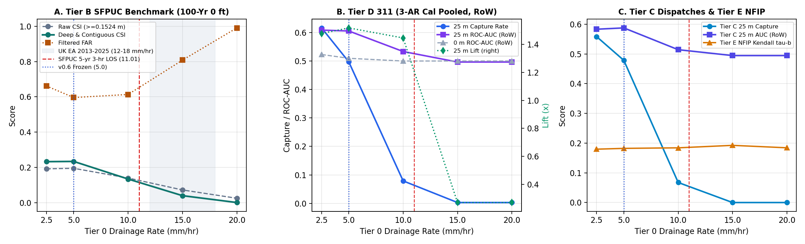

# SF Bay Urban Flood Map v0.6.1 — Phase 3 Sensitivity Report

## 1. Drainage-Rate Sensitivity Sweep (Item 19)

SFPUC's SSIP Level of Service (LOS) design storm is the **5-year, 3-hour storm (1.28 in / 32.5 mm total, peak 1-hour depth 0.72 in / 18.3 mm; derived from a 1941 City IDF curve; San Francisco Public Works, 2017, Sec. 3.1 & Table 3)**, implying a mean rate of **10.84 mm/hr** (~10.8 mm/hr) and a peak-hour rate of **~18.3 mm/hr** (approximate comparison because the 1941 City IDF basis differs from the NOAA Atlas 14 basis of the design storms; comparable to England's Environment Agency 12–18 mm/hr urban defaults).

| Rate (mm/hr) | Tier B Raw CSI | Tier B Filtered CSI (FAR) | Tier D 3-AR Pooled 25 m RoW (Cap / Lift / AUC) | Tier C 3-AR Pooled 25 m RoW (Cap / AUC) | Tier E NFIP Area $\tau_b$ |
| --- | --- | --- | --- | --- | --- |
| 2.5 | 0.1925 | 0.2331 (0.6613) | 61.62% / 1.479x / 0.6084 | 55.83% / 0.5832 | 0.1796 |
| 5.0 | 0.1953 | 0.2344 (0.5961) | 49.71% / 1.519x / 0.6054 | 47.85% / 0.5876 | 0.1823 |
| 10.0 | 0.1403 | 0.1347 (0.6135) | 7.89% / 1.447x / 0.5333 | 6.75% / 0.5143 | 0.1841 |
| 15.0 | 0.0729 | 0.0405 (0.8079) | 0.29% / 0.269x / 0.4964 | 0.00% / 0.4945 | 0.1924 |
| 20.0 | 0.0257 | 0.0016 (0.9903) | 0.29% / 0.269x / 0.4964 | 0.00% / 0.4945 | 0.1842 |

## 2. Atlas 14 Vol. 6 Temporal Distribution Sensitivity (Item 21)

Temporal distribution: **CA Region 8 24-hr ALL CASES 50% (median)** vs. alternating block (at 5.0 mm/hr Tier 0).

| Scenario | Method | Peak Intensity (mm/hr) | Flooded $\ge 0.05$ m (km²) | Flooded $\ge 0.1524$ m (km²) | Tier B Raw / Filtered CSI |
| --- | --- | --- | --- | --- | --- |
| sf_citywide_10yr_slr0ft | Alternating Block | 44.00 | 3.894 | 2.535 | n/a |
| sf_citywide_10yr_slr0ft | Atlas 14 TD (50%) | 4.81 | 1.041 | 0.923 | n/a |
| sf_citywide_100yr_slr0ft | Alternating Block | 66.80 | 7.373 | 5.146 | 0.1953 / 0.2344 |
| sf_citywide_100yr_slr0ft | Atlas 14 TD (50%) | 7.66 | 4.160 | 2.910 | 0.1280 / 0.1184 |

## 3. Tier A Leave-One-Gauge-Out Geometry Check (Item 20)

- **In-domain gauges:** 9414290 (Presidio)
- **Out-of-domain gauges:** 9414750 (Alameda), 9414863 (Richmond), 9414523 (Redwood City)
- **Status:** Retained as boundary-condition QA for SF-only domain; leave-one-gauge-out deferred to multi-gauge v0.7+/v1.0 domain.
